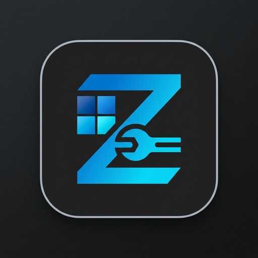
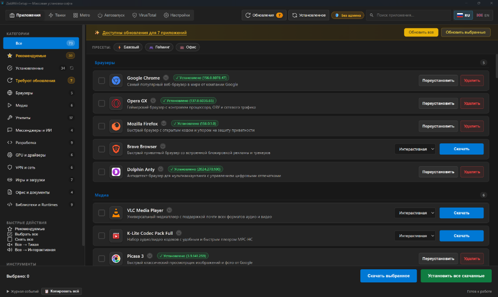
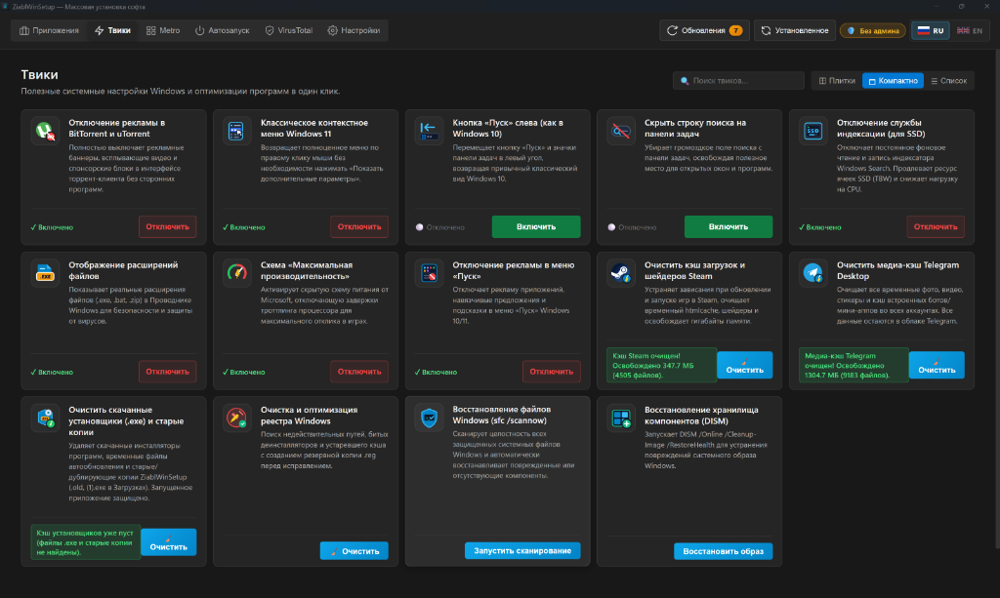
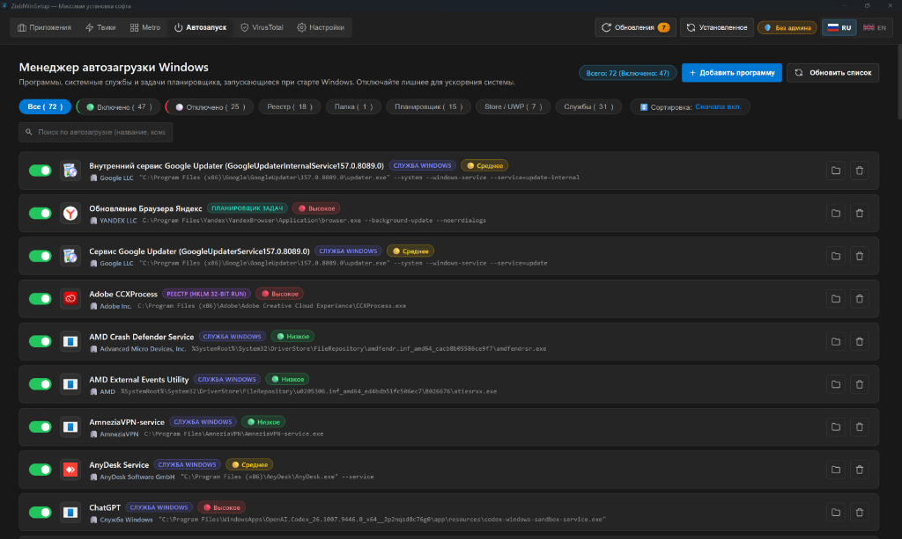
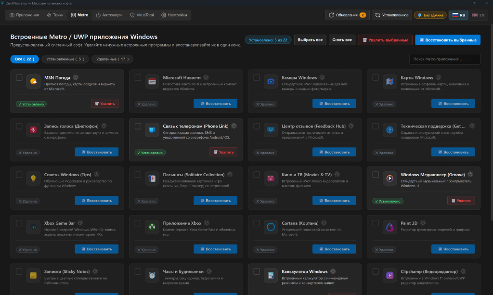
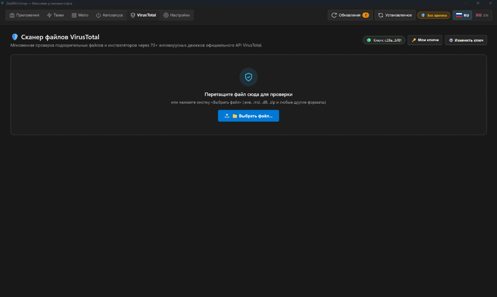
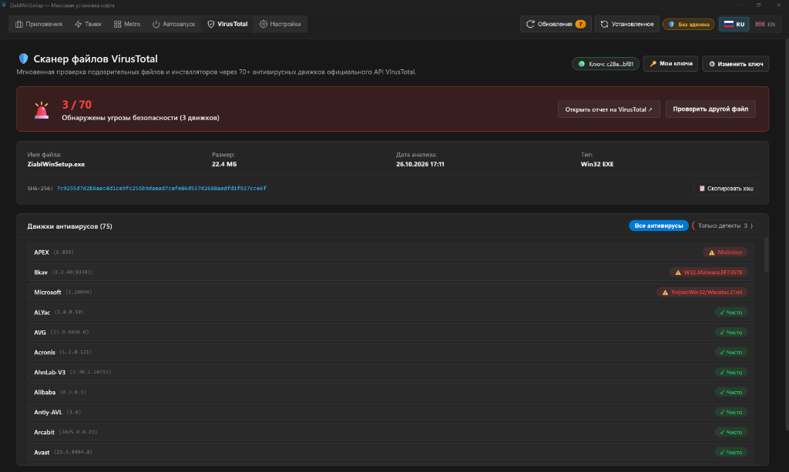
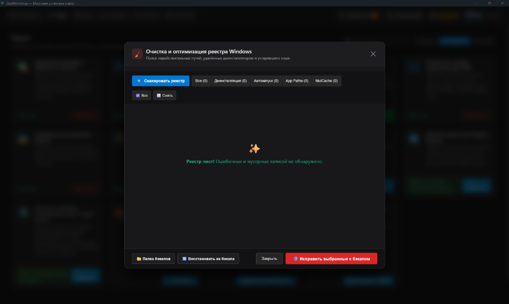
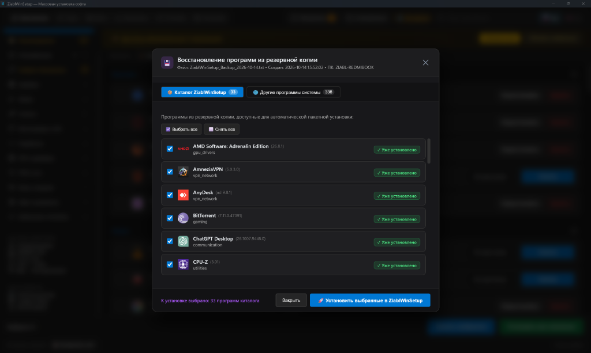
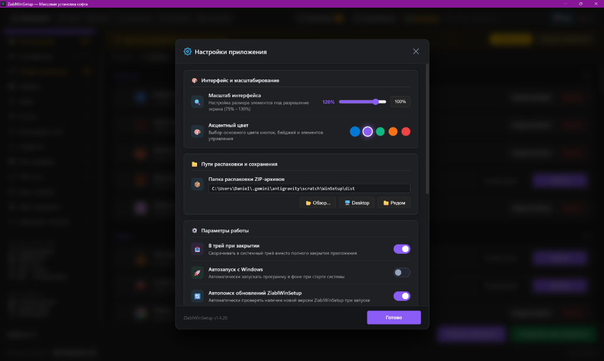

# 🚀 ZiablWinSetup

<div align="center">
  
  <h3>Современный швейцарский нож для Windows 10 / 11</h3>
  <p><b>Массовая пакетная установка софта, умные системные твики, деблоатер, замер автозагрузки, очистка реестра и сканер VirusTotal</b></p>

  <p>
    <a href="https://github.com/DanielCarti/ZiablWinSetup/releases/latest"></a>
    <a href="https://github.com/DanielCarti/ZiablWinSetup/releases/latest"></a>
    
    
    
  </p>

  <p align="center">
    
  </p>
</div>

---

## 🌟 О проекте

**ZiablWinSetup** — это комплексный, автономный и быстрый инструмент для настройки, обслуживания и автоматической подготовки рабочей среды Windows после чистой переустановки ОС или покупки нового ПК/ноутбука.

Забудьте о ручном скачивании десятков инсталляторов из браузера, назойливой рекламе и кликах «Далее-Далее-Готово»: выберите нужный софт галочками или пресетом, примените проверенные системные твики, удалите лишний bloatware и нажмите **«Скачать выбранное»**!

---

## 📸 Галерея интерфейса

| Каталог софта и пресеты | Твики системы (компактный вид) |
| :---: | :---: |
|  |  |
| **Менеджер автозагрузки с замером нагрузки** | **Деблоатер предустановленных Metro-приложений** |
|  |  |
| **Сканер VirusTotal с Drag & Drop** | **Отчёт анализа 70+ антивирусных движков** |
|  |  |
| **Очистка и оптимизация реестра** | **Восстановление программ из бэкапа** |
|  |  |
| **Кастомизация акцентов и масштабирование** | |
|  | |

---

## ✨ Ключевые возможности

### 📦 1. Богатый каталог приложений (73 программы) и быстрые пресеты

<p align="center">
  
</p>

Все приложения распределены по 10 категориям с моментальным поиском и фильтрацией:

* 🌐 **Браузеры**: Google Chrome, Opera GX, Mozilla Firefox, Brave Browser, Dolphin Anty
* 🎬 **Медиа**: VLC Media Player, K-Lite Codec Pack Full, Picasa 3, OBS Studio, Adobe Photoshop, Adobe Premiere Pro
* 🔧 **Системные утилиты**: 7-Zip, WinRAR, Everything, Total Commander, EarTrumpet, CPU-Z, HWiNFO, Rufus, ShareX, Microsoft PowerToys, CrystalDiskInfo, CrystalDiskMark, OCCT, Uninstall Tool, IObit Unlocker, Unchecky, HitmanPro
* 📚 **Библиотеки и Runtimes**: DirectX End-User Runtimes (June 2010), Visual C++ Runtimes All-in-One, Visual C++ 2015–2022 (x64/x86), .NET Desktop Runtime 8.0/9.0/6.0, .NET Framework 4.8.1, .NET Framework 3.5
* 💬 **Мессенджеры и ИИ**: Telegram Desktop, Discord, Claude Desktop, ChatGPT Desktop
* 💻 **Разработка**: Visual Studio Code, PyCharm Community, Sublime Text, Notepad++, Git, Python 3, Eclipse Temurin JDK 21, OpenAI Codex CLI, OpenCode AI
* 🖥️ **GPU и драйверы**: NVIDIA App, AMD Software: Adrenalin Edition, GPU-Z, FurMark 2, IObit Driver Booster, NVIDIA Broadcast
* 🔒 **VPN и безопасность**: AmneziaVPN, Zapret (обход замедлений YouTube и Discord), YogaDNS, Tg-WS Proxy, Opera Proxy, AnyDesk
* 🎮 **Игры и загрузки**: Steam, Hydra Launcher, Roblox, TLauncher (Minecraft), qBittorrent, BitTorrent, Dropbox
* 📑 **Офис и документы**: Obsidian, LibreOffice, Apache OpenOffice, Todoist

**Фирменные возможности менеджера загрузок:**
- ⚡ **Быстрые пресеты в 1 клик**: «Обязательный», «Гейминг», «Офис» для мгновенного набора софта под задачу.
- 🚀 **Параллельная тихая установка**: загрузка в несколько потоков с автоматическим пропуском диалогов инсталляторов.
- 📦 **Автоматическая распаковка архивов**: автоматическое развёртывание ZIP-пакетов и создание готовых ярлыков на Рабочем столе.
- 🔍 **Контекстный поиск**: глобальный поиск только в каталоге софта без перебивания фильтров на соседних вкладках.

---

### 🔄 2. Интеллектуальный центр обновлений софта

- **Автоматический мониторинг версий**: сканирование установленного софта через Winget CLI и официальный GitHub Releases REST API.
- **Информативная панель**: верхний баннер с точным количеством найденных обновлений.
- **Кнопка «Обновить» на карточке**: подсветка устаревших программ и обновление любой из них в один клик.
- **Исключения из обновлений**: гибкое скрытие специфических версий ПО или кастомных сборок из списка массового обновления.
- **Синхронизация на лету**: мгновенное повторное сканирование системы без перезапуска приложения.

---

### ⚡ 3. Твики и оптимизация Windows («Твики»)

<p align="center">
  
</p>

- 🎛️ **3 режима отображения**: переключайтесь между карточками (`⊞ Плитки`), компактной сеткой (`🗖 Компактно`) и списком (`☰ Список`) — выбор автоматически сохраняется!
- 🔍 **Собственный локальный поиск**: удобная фильтрация нужного твика без переключения контекста.
- ⚡ **Мгновенное применение без перезагрузки explorer.exe**: твики панели задач и проводника используют системные события `WM_SETTINGCHANGE` и `SHChangeNotify`, вступая в силу в реальном времени.

| Твик | Описание и эффект |
| :--- | :--- |
| 🚀 **Максимальная производительность** | Разблокировка и активация скрытой схемы электропитания Windows *Ultimate Performance*. |
| 📁 **Показ расширений файлов** | Включение отображения расширений всех типов файлов в Проводнике Windows. |
| 📋 **Классическое контекстное меню** | Возврат классического контекстного меню в стиле Windows 10 в Windows 11. |
| 🚫 **Блокировка рекламы в торрентах** | Отключение баннеров и промо-блоков в клиентах BitTorrent и uTorrent. |
| 💾 **Отключение индексации SSD** | Остановка службы поиска `WSearch` для продления ресурса SSD-накопителя (TBW). |
| 🔍 **Скрытие поиска на Панели задач** | Отключение громоздкой поисковой строки для освобождения места на Панели задач. |
| 📌 **Выравнивание Панели задач влево** | Перенос меню «Пуск» и закреплённых иконок к левому краю экрана. |
| 🧹 **Очистка кэша Steam** | Безопасное удаление накопившегося кэша браузера, шейдеров и временных файлов загрузок. |
| 💬 **Очистка медиа-кэша Telegram** | Освобождение дискового пространства от кэша медиа Telegram Desktop. |
| 🔇 **Отключение рекламы в меню Пуск** | Блокировка рекомендаций и спонсорских приложений в меню «Пуск». |
| 🧹 **Очистка инсталляторов ZiablWinSetup** | Освобождение места от временных дистрибутивов программ после установки. |
| 🛡️ **Очистка и оптимизация реестра** | Моментальный запуск модуля поиска и исправления проблемных записей реестра. |
| 🛠️ **Проверка целостности SFC** | Запуск системного сканирования и восстановления повреждённых файлов (`sfc /scannow`). |
| 🏥 **Восстановление образа DISM** | Запуск сканирования и починки системного образа Windows через `DISM /RestoreHealth`. |

---

### 🚀 4. Менеджер автозагрузки с анализом нагрузки

<p align="center">
  
</p>

Полноценный диагностический центр автозапуска, превосходящий стандартный Диспетчер задач:
- 📊 **Оценка влияния на запуск (Impact)**:
  - 🔴 **Высокое** — ресурсоёмкие клиенты, фоновые лаунчеры и тяжелые службы.
  - 🟡 **Среднее** — сервисы синхронизации и утилиты периферии.
  - 🟢 **Низкое** — легковесные службы, фоновые трей-агенты.
  - ⚪ **Не замерено** — недавно добавленные элементы.
- 🔍 **Глубокий охват всех системных источников**:
  - Пользовательский и системный реестр: `HKCU\Run`, `HKLM\Run`, `HKLM\RunOnce`, `WOW6432Node`.
  - Системные службы Windows (`services.msc`).
  - Планировщик задач Windows (`Task Scheduler`).
  - Папки автозагрузки (`Startup` в `%APPDATA%` и `%PROGRAMDATA%`).
  - UWP/Metro приложения с автозапуском.
- 🛡️ **Безопасное включение и отключение**: использование официального Windows-механизма `StartupApproved`, предотвращающего безвозвратное удаление путей к исполняемым файлам.
- 📂 **Быстрый переход к файлу**: открытие расположения программы в Проводнике (`explorer.exe /select`) в 1 клик.

---

### 📥 5. Менеджер загрузок (Downloads Manager) со скоростью и ETA

- ⚡ **Реальная скорость и объём данных**: непрерывный подсчёт скорости передачи (`МБ/с` или `КБ/с`), переданных мегабайт и расчёт оставшегося времени (`ост. XXс`), в том числе для Winget и прямых сетевых загрузок.
- 🛑 **Мгновенная отмена**: надёжное прерывание активных сетевых сокетов и фоновых подпроцессов без зависаний программы и без мусора на диске.
- 📊 **Отдельная вкладка «Загрузки»**: удобная сводная панель активных, завершённых и прерванных загрузок с живым бейджем-счётчиком в навигационной панели.
- 📂 **Быстрый переход**: открытие папки загрузок или конкретного скачанного установщика в Проводнике Windows в 1 клик.
- 🧹 **Очистка истории и кэша**: безопасное удаление временных файлов `.part`, `.tmp` и старых дистрибутивов.

---

### 🪟 6. Деблоатер встроенных Metro / UWP приложений

<p align="center">
  
</p>

- **Контроль над 22 встроенными приложениями**: Погода MSN, Новости, Кортана, Связь с телефоном, Камера, Карты, Xbox Game Bar, Запись голоса, Советы, Microsoft Solitaire, Paint 3D, Clipchamp и др.
- **Удаление в один клик**: чистое удаление предустановленного мусора через PowerShell AppX API.
- **Восстановление в один клик**: регистрация пакета обратно из системного хранилища Windows или переход на страницу в Microsoft Store (с автоматическим веб-фоллбэком, если Store удалён из системы).
- **Пакетные операции**: удобные чекбоксы для одновременного удаления или восстановления группы приложений.

---

### 🛡️ 6. Встроенный сканер VirusTotal с хранилищем ключей

<p align="center">
  
  
</p>

- ⚡ **Мгновенный хэш-поиск**: вычисление SHA-256 файла прямо на стороне клиента через Web Crypto API и моментальное получение отчёта из базы VirusTotal без долгой отправки файла по сети.
- 📤 **Автоматическая загрузка новых файлов**: если хэш ещё не известен VirusTotal, файл отправляется на анализ напрямую через официальный API v3.
- 📁 **Два режима выбора файла**: удобный Drag & Drop прямо в окно приложения или нативный системный проводник Windows через чистый Win32 `comdlg32`.
- 🔑 **Менеджер «Мои ключи»**: сохраняйте несколько собственных API-ключей VirusTotal, переключайтесь между ними в 1 клик или используйте встроенный системный шлюз.
- 📊 **Подробный отчёт**: количество детектов, точный вердикт каждого из 70+ антивирусных движков, категория угрозы, дата сканирования и кнопка копирования SHA-256.

---

### 🧹 7. Очистка и оптимизация системного реестра

<p align="center">
  
</p>

- 🔎 **Интеллектуальное сканирование**:
  - Остатки удалённых программ в списках деинсталляции (`Uninstall`).
  - Недействительные записи автозапуска (`Run` / `RunOnce`).
  - Ошибочные пути приложений в `App Paths`.
  - Устаревший кэш шрифтов и интерфейса `MuiCache`.
- 💾 **Автоматический бэкап**: перед любым изменением реестра автоматически создаётся восстановительный файл `.reg` с датой и временем.
- 🛡️ **Честная проверка и безопасность**: удаление защищённых системных записей HKLM с разовым запросом UAC-повышения, физической верификацией удаления ключа и встроенной кнопкой «Восстановить из бэкапа».

---

### 💾 9. Резервное копирование и перенос софта

<p align="center">
  
</p>

- 📋 **Резервная копия установленного ПО**: экспорт списка программ с текущего компьютера в компактный текстовый манифест.
- 🔄 **Пакетное развёртывание**: на новом или только что переустановленном компьютере откройте бэкап и отметьте нужные программы для автоматической пакетной установки через ZiablWinSetup.
- ⚙️ **Умный фильтр драйверов и компонентов**: системные драйверы (Realtek, AMD, Intel) и скрытые зависимости аккуратно отделены от пользовательских приложений переключателем.

---

### 🎨 10. Персонализация, масштабирование и эргономика

<p align="center">
  
</p>

- 🎨 **Выбор акцентного цвета**: выберите фирменный цвет под оформление рабочего стола:
  - 🔵 **Windows Blue** (Классический синий)
  - 🟣 **Cyber Purple** (Неоновый фиолетовый)
  - 🟢 **Emerald Green** (Изумрудный зелёный)
  - 🟠 **Sunset Orange** (Закатный оранжевый)
  - 🔴 **Crimson Red** (Багровый красный)
- 🔍 **Масштаб интерфейса (75% – 130%)**: адаптация под любые разрешения мониторов от компактных ноутбуков до 4K-экранов.
- ↔️ **Регулируемые панели**: изменяйте ширину бокового меню категорий и высоту панели системного лога простым перетаскиванием мыши (размеры сохраняются).
- 🛡️ **Индикатор прав администратора**: наглядный бейдж в заголовке («Админ» / «Без админа») с возможностью безопасного перезапуска от имени администратора в 1 клик.
- 🌍 **Полная двуязычность**: моментальное переключение между русским и английским языками (RU / EN) на лету.
- 🔔 **Системный трей**: фоновая работа, контекстное меню быстрого доступа и опция тихого старта вместе с Windows (`--tray`).

---

## 🚀 Как запустить

### Вариант 1. Готовый исполняемый файл (Рекомендуется)

Не требует установки Python и каких-либо сторонних компонентов:

👉 **[Скачать актуальный ZiablWinSetup.exe](https://github.com/DanielCarti/ZiablWinSetup/releases/latest)**

1. Скачайте файл `ZiablWinSetup.exe`.
2. Запустите его (для полного доступа ко всем твикам и реестру рекомендуется запуск от имени администратора).

---

### Вариант 2. Запуск из исходного кода

```bash
# Клонируйте репозиторий
git clone https://github.com/DanielCarti/ZiablWinSetup.git
cd ZiablWinSetup

# Установите зависимости
pip install -r requirements.txt

# Запустите проект
python main.py
```
Либо дважды кликните по файлу `run.bat`.

---

## 🛠️ Сборка собственного EXE

Для компиляции автономного исполняемого файла используется **PyInstaller**:

```bash
pyinstaller --clean ZiablWinSetup.spec
```
Или запустите готовый командный файл:
```cmd
build.bat
```
Собранный `.exe` будет находиться в папке `dist/ZiablWinSetup.exe`.

---

## 💻 Стек технологий

- **Ядро**: Python 3.10+ (Win32 ctypes, winreg, subprocess, urllib)
- **GUI-движок**: [pywebview](https://pywebview.flowrl.com/) на базе Microsoft Edge WebView2 (Chromium)
- **Фронтенд**: HTML5, Vanilla CSS3 (Fluent Design System, CSS Variables, Flexbox/Grid), Web Crypto API
- **Пакетные менеджеры & API**: Winget CLI, GitHub REST API, VirusTotal API v3
- **Сборка и автоматизация**: PyInstaller, GitHub Actions (.github/workflows/release.yml)

---

## 📄 Лицензия

Проект распространяется под свободной лицензией **MIT**. Подробности в файле [LICENSE](LICENSE).
